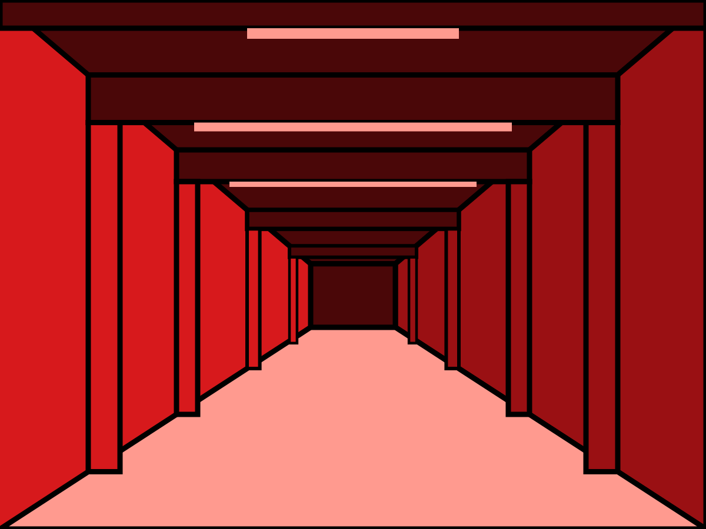
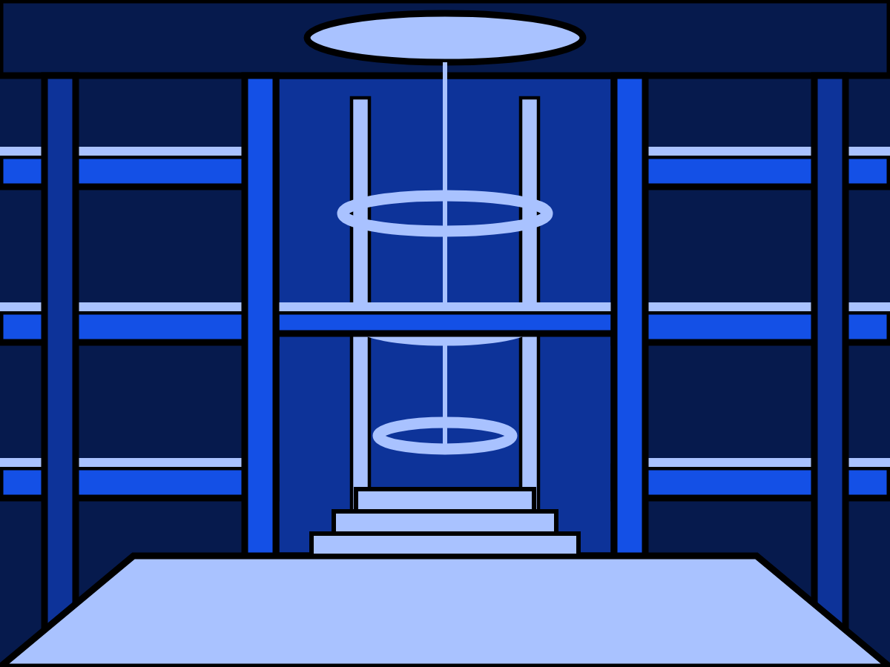
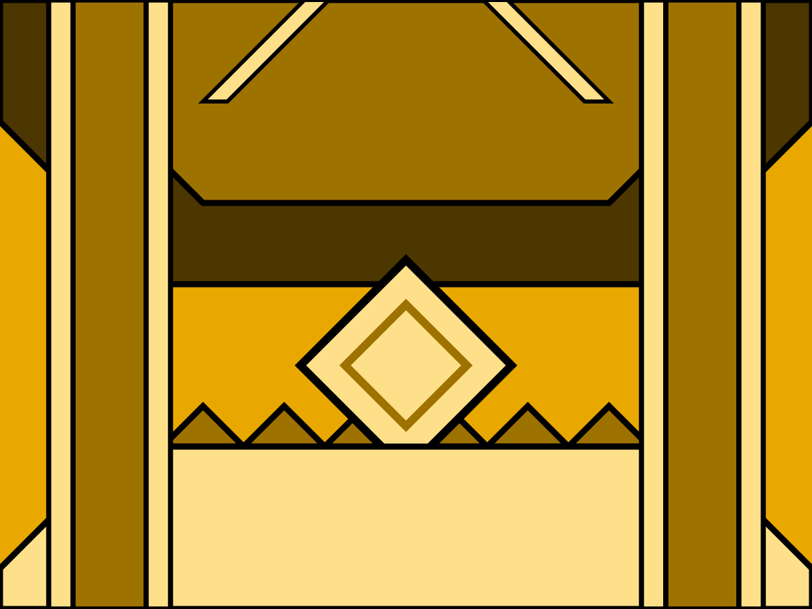
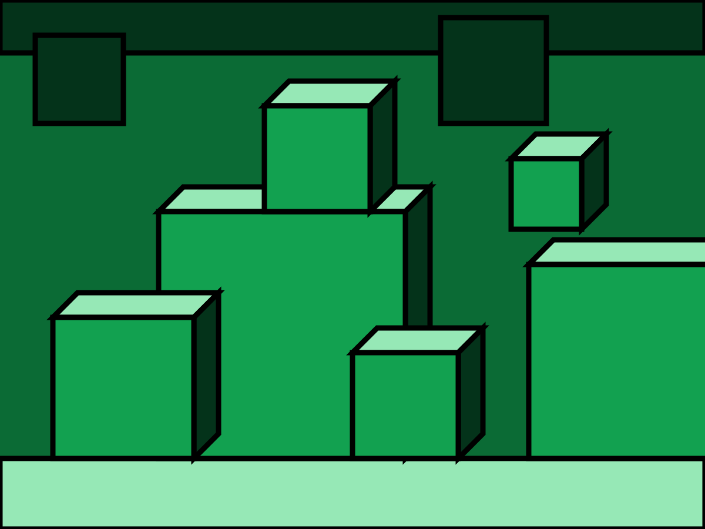

# InDebtEd — Level Design Guide: Pop Brutalism

Oct 20, 2026 · @Geoffrey Cook

## Design pillars

InDebtEd's spaces are brutalist concrete, flooded with one flat Pop Art
color per district. The concrete says institution, permanence and
weight; the color says brand, advertising and debt. Each district
belongs to one of the four card/ammo brands — RED, BLU, GLD, GRN — and
its architecture is that brand's personality made physical.

1.  **Concrete is the canvas, color is the logo.** Board-formed concrete
    everywhere, with every surface in the district hue; color reads like
    ink on a print, never like weathering.

2.  **One color per space.** A district is monochrome. Districts are
    separated by black, and unclaimed space is white (see Transitions).

3.  **Form tells you where you are before color does.** Each brand has
    its own architectural grammar, so a player who is colorblind or in a
    dark room still reads the district from its silhouette.

4.  **Monumental and absurd.** Scale is oppressive, the way a bank lobby
    or tax office is oppressive. The satire comes from that scale being
    painted like a cereal box.

5.  **Readable combat first.** Every vibe rule below bends before
    sightlines, cover and navigation do.

## Shared brutalist foundation

All four districts share one base kit so they feel like the same city
run by competing landlords. These rules hold everywhere unless a
district section overrides them.

**Materials**

- Board-formed concrete as the default surface: visible plank lines, tie
  holes, pour seams. Grain direction runs vertically on columns and
  horizontally on walls.

- Secondary materials are sparse and cheap-looking: dark glass, painted
  steel rails, rubber flooring, office furniture. Plants only appear as
  corporate decoration (planters, living walls), never as nature
  reclaiming the space.

- No grime soup. Wear exists (staining under ledges, chipped edges) but
  surfaces read clean and flat, so the Pop color sits on them crisply.

- Larger signs of neglect follow the market decay rules in Lo-fi print
  treatment.

**Massing and scale**

- Thick everything: columns, beams and slabs are oversized relative to
  load. Overhangs and coffers are the default ceiling vocabulary.

- Strong repetition: colonnades, rhythmic piers, stacked identical
  windows. Repetition is what makes a single broken rhythm (an exit, an
  objective, a secret) pop.

- Human scale is deliberately undercut. Doors and service hatches are
  small next to massive structure.

**Lighting**

- Light is architectural, not decorative: ring pendants, light slots cut
  into concrete, skylights and clerestories. Each district gets one
  signature fixture (see district sections).

- High contrast, with falloff resolved into dithered value bands.
  Concrete gets its drama from raking light across board texture.

- Shadows stay in the district hue. District styles and rules are in
  Lighting by district.

**Signage and graphics**

- Wayfinding is big, flat and typographic: department names, floor
  numbers, brand marks stenciled or inlaid in color.

- Satirical copy (fee schedules, terms and conditions, motivational
  banners) lives on signage, never on walls players need to read for
  navigation.

## The Pop color system

Each district is one hue on every surface, including what used to be
grey, and value does the wayfinding. Hex values below come from the Pop
Brutalism mood board and are starting points to tune in-engine.

| Brand | District   | Path hex | Structure hex | Shadow hex | Overhead hex | Material echo (from ammo packaging) |
|-------|------------|----------|---------------|------------|--------------|-------------------------------------|
| RED   | Industrial | \#FF9A8F | \#D7191C      | \#9A1013   | \#4A0708     | Industrial metal                    |
| BLU   | Lofty      | \#A9C2FF | \#1450E6      | \#0D3399   | \#061A4D     | Clicky plastic                      |
| GLD   | Angular    | \#FFE08A | \#E8A800      | \#9E7200   | \#4D3700     | Premium / lofty finish              |
| GRN   | Cubic      | \#96E8B6 | \#12A150      | \#0B6B35   | \#04331A     | Cardboard                           |

**The value ladder**

- **Path**: the lightest value. Floors, stairs and other walking
  surfaces.

- **Structure**: the district's main hue. Walls, piers and major forms.

- **Shadow**: darker planes, recesses and low cover.

- **Overhead**: the deepest value. Ceilings, undersides and services.

- **Ink**: flat, texture-free brand color. Reserved for things that
  matter: doors, objectives, cover edges, brand marks and signature
  light fixtures.

**Pop Art rules**

- Ink surfaces are flat. No gradients, no noise, no roughness variation
  on them.

- Halftone (Ben-Day dot) decals in the district hue grow denser toward a
  district's core. They stop dead at the black transition.

- Thick black keylines (painted or inlaid steel) outline ink elements on
  signage and objective props, like print outlines.

- No other hue enters a district, and no surface is white or grey. Black
  is limited to keylines and transitions. Health, pickups and UI keep
  their own reserved colors, which none of the four brands may use, and
  combat marks are a temporary exception.

**Gameplay meaning of color**

- Ink = interactive or important. Players learn this in the first level
  and it never breaks.

- Halftone density = depth into territory. Denser dots mean you are
  closer to the brand's core and its strongest enemies.

## Lo-fi print treatment

Districts are crunchy and printed; the comic-page structure stays razor
sharp. Borrow the deliberate lo-fi treatment and environmental
storytelling of [Queen's
Domain](https://www.pcgamer.com/games/rpg/were-hitting-peak-saturation-for-first-person-dungeon-crawlers-but-queens-domain-stands-apart-from-the-crowd),
not its PS1 look or muted palette. Readable combat still wins every
conflict. Values below are starting points to test in-engine.

| Element                                   | Treatment                                                               | Rule                                                |
|-------------------------------------------|-------------------------------------------------------------------------|-----------------------------------------------------|
| District concrete                         | Low-res, nearest-neighbor texture; ordered dither in shadow and falloff | Start at 64 px per 100 cm and a 4×4 Bayer pattern   |
| Signage, ads, packaging                   | Low-res print texture with visible pixels                               | Shared pixel density across all four brands         |
| Ink surfaces                              | No dither or texture                                                    | Stay flat, as in the Pop Art rules                  |
| Black transitions and white neutral areas | No dither or texture                                                    | Always crisp; never pixelated                       |
| HUD, ticker, WALLET, gun parts, receipts  | Shared limited palette and pixel density                                | Text and critical readouts stay legible at a glance |

**Dither rules**

- Dither only between neighboring steps of the district's own ramp. It
  never adds a hue.

- Keep bands clean: walking surfaces must still read as the lightest
  value at a glance, while moving and in combat.

- Use ordered dither for lighting and falloff. Halftone stays reserved
  for printed decals and territory depth.

**Market decay**

- Decay tells a brand's story through layered ads, abandoned kiosks,
  stained concrete and dead signs, all in the district's own color.

- The day seed sets it at wake-up from that day's brand Worth, so a
  low-Worth district looks neglected. It does not change mid-run.

- Decay never covers ink, black transitions or the walking path.

**Enemies**

- Lock silhouettes first, then let low-res detail make corrupted mascots
  and corporate drones more unsettling.

- BLU pushes furthest: its textures and details never quite resolve,
  matching its illegibility everywhere else.

**Avoid**: muted or earthy palettes, a uniform full-screen pixelate or
dither filter, and lo-fi treatment on everything.

## Lighting by district

Each brand has its own preliminary lighting style, but none may break
the value ladder: the walking path stays the lightest thing in the
player's route. Treat every value here as a starting point for in-engine
tests.

| Brand | Style                 | Main sources                                    | Shadows                                 | How it guides the player                                                               |
|-------|-----------------------|-------------------------------------------------|-----------------------------------------|----------------------------------------------------------------------------------------|
| RED   | Hard and oppressive   | Short-throw caged strips under beams            | Hard-edged bands between bays           | Parallel strips run along the route; the next bay stays partly hidden                  |
| BLU   | Vast and unreliable   | High oculi, skylights and stacked ring pendants | Long, soft and hazy                     | The brightest shaft marks the main vertical route; pendants drift slightly out of sync |
| GLD   | Theatrical and raking | Diagonal slots and diamond fixtures             | Sharp, cut along 45° lines              | Light catches chamfers and points toward the vault or objective                        |
| GRN   | Flat and cheap        | Cube lightboxes with big-box-store evenness     | Minimal, small and hard under overhangs | Lit cube clusters mark climbable routes and key areas                                  |

**Rules for every district**

- Tint light to the district hue. Only black transitions and white
  neutral areas use white light.

- Keep shadows in the district's own shadow and overhead values, not
  neutral grey or black.

- Enemies and interactive ink must stay readable in the darkest space
  they can occupy.

- Set light states from brand Worth at wake-up: higher Worth means
  working fixtures; lower Worth adds dead fixtures that never block the
  walking path.

- Keep flicker rare and subtle, and include it in the reduced-flashing
  setting.

**First test**: build one short combat space per district with the same
enemy and gun. Check path readability, enemy visibility and dither
stability before tuning mood.

## RED — Industrial, flat, claustrophobic

RED is the factory floor of debt: low, heavy, horizontal spaces that
press down on the player. Think the repeating pier corridor and the
tight concrete shaft in the references, with the ceiling dropped another
meter.

Concept illustration from the Pop Brutalism mood board: low beams,
repeating piers and a light walking path.

**Architectural language**

- Horizontal everything: long slabs, deep beams, continuous ledges.
  Almost no vertical gestures.

- Orthogonal only. 90-degree corners, no chamfers, no curves.

- Exposed services: ducts, pipe racks, cable trays and conveyors bolted
  to concrete. Painted steel in RED ink.

- Repeating piers and bays that compress the view and hide what is two
  bays ahead.

- Openings are slots, hatches and roller doors, never grand portals.

**Spatial targets (UE units, cm)**

| Element                         | Target  |
|---------------------------------|---------|
| Corridor width                  | 250–400 |
| Ceiling height, corridors       | 300–380 |
| Ceiling height, largest room    | ≤ 700   |
| Beam drop below ceiling         | 60–120  |
| Pier spacing                    | 400–600 |
| Longest uninterrupted sightline | ~2500   |

**Combat feel**: close quarters, corner fights, flanking through
parallel service corridors. Favors shotguns and SMGs. Cover is
structural (piers, machinery) rather than placed props.

**Signature light**: caged linear strips mounted under beams, running in
long parallel lines.

**Color use**: Path value on floors and structure value on walls, with a
darker dado band at ~120 cm that reads as factory safety paint. RED ink
on machinery, roller doors and hazard edges.

**Avoid**: big atriums, skylights, diagonal geometry, anything that lets
the player breathe for long.

## BLU — Lofty and open

BLU is the corporate headquarters: vast atriums, ceremonial stairs and
balconies stacked up into daylight. The rotunda and the grand-stair
atrium in the references are the template; the player should feel small
and watched.

Concept illustration from the Pop Brutalism mood board: stacked
galleries, ring pendants and a light central stair.

**Architectural language**

- Vertical emphasis: tall piers, full-height light slots, ribbed walls
  that pull the eye upward.

- Volume over surface. Rooms are open wells ringed by galleries and
  mezzanines on several levels.

- Bridges, cantilevered landings and switchback stairs cross the void.

- Light from above: oculi, skylights, clerestories. Daylight is the BLU
  brand's luxury.

- Curves are allowed here and only here (rotundas, ring galleries),
  always heavy and concrete.

**Spatial targets (UE units, cm)**

| Element                 | Target    |
|-------------------------|-----------|
| Atrium height           | 2000–4000 |
| Gallery / balcony depth | 300–500   |
| Gallery floor-to-floor  | 450–600   |
| Main stair width        | 600+      |
| Longest sightline       | 8000+     |

**Combat feel**: long-range and vertical. Snipers on galleries, fights
across the void, falling and dropping between levels as movement
options. Give every high perch a counter-angle so height is strong but
not dominant.

**Signature light**: large ring pendants on long cables, stacked down
the height of the atrium.

**Color use**: path value on floors and stairs, structure value on
galleries and overhead value in the ceiling, all under blue daylight.
BLU ink on balustrade caps, stair stringers and the ring pendants, so
the color traces the vertical routes.

**Avoid**: low ceilings outside of short connector halls, cluttered
floors, anything that blocks the view up.

## GLD — Angles at 45 degrees

GLD is premium credit: ziggurats, chamfers and diamond forms that feel
expensive and slightly sinister. The stepped, cantilevered tower and the
triangular skylights in the references point the way; every form should
look cut, not poured.

Concept illustration from the Pop Brutalism mood board: chamfered forms,
octagonal columns and a diamond focal point.

**Architectural language**

- The 45-degree rule: walls, piers, soffits and openings sit at 0, 45 or
  90 degrees. No other angles, no curves.

- Chamfered corners on everything structural. A GLD column is an octagon
  or a diamond, never a square.

- Stepped and ziggurat profiles: inverted steps on ceilings, terraced
  floors, sawtooth facades.

- Diamond and triangular openings, triangular coffers, diagonal light
  slots.

- Plan layouts rotate 45 degrees off the world grid in key rooms, so the
  player's sense of north gets knocked off.

**Spatial targets (UE units, cm)**

| Element                         | Target   |
|---------------------------------|----------|
| Chamfer size on piers           | 50–100   |
| Step height (ziggurat profiles) | 100–200  |
| Ceiling height, halls           | 600–1200 |
| Diagonal corridor width         | 400–600  |
| Snap angle                      | 45°      |

**Combat feel**: diagonal lanes create unusual peek angles and
wedge-shaped cover. Players fight around points and into corners.
Stepped terraces give layered mid-range positions.

**Signature light**: diagonal light slots and diamond-shaped recessed
fixtures, tinted warm gold.

**Color use**: Stepped surfaces alternate structure and shadow values,
so each step reads separately. GLD ink on edges and chamfer faces, which
makes the angles themselves glow.

**Avoid**: shallow or arbitrary angles (30 or 60 degrees muddy the
language), rounded forms, plain boxes.

## GRN — Overlapping cubes

GRN is the budget brand built from stacked boxes: every space is made of
cube volumes that interpenetrate, cantilever and pile up into larger
forms. The projected-cube wall and the stacked-box tower in the
references are the cue, pushed further toward shipping crates and
cardboard.

Concept illustration from the Pop Brutalism mood board: overlapping
cubes with light, walkable tops.

**Architectural language**

- Everything is a cube or a cuboid on a fixed module. Shapes are made by
  overlapping cubes, never by drawing new outlines.

- Overlaps create the features: where two cubes intersect you get an
  arch, a window, a stair or a cover position.

- Cantilevered and offset boxes: volumes pushed out of walls, hanging
  off ceilings, stacked off-center.

- Walls read as pixel-like reliefs, with cubes protruding at different
  depths.

- Scale jumps between modules (small, medium, large cubes in the same
  view) keep it from feeling like a voxel grid.

**Spatial targets (UE units, cm)**

| Element               | Target                  |
|-----------------------|-------------------------|
| Cube modules          | 100 / 200 / 400 / 800   |
| Max overlap per cube  | 25–50% of its width     |
| Cantilever reach      | up to 1 module          |
| Ceiling height, rooms | 400–1200 (stepped)      |
| Stair step            | half of smallest module |

**Combat feel**: dense mid-range fights with abundant cube cover.
Stacked boxes create climbable vertical routes and small sniper nests.
Overlap gaps make peek windows and murder holes.

**Signature light**: cube lightboxes, glowing from within, recessed or
floating in clusters.

**Color use**: Path value on walkable tops, structure value on cube
faces and overhead value on undersides. GRN ink on the cubes that are
interactive or climbable.

**Avoid**: angles, curves, freeform walls, and perfectly aligned grids
with no overlap.

## Transitions and neutral space

Every transition between districts is black: a black line or a black
space. Any area that belongs to no district is white and colorless. Like
a comic page, the districts are the panels and the black transitions are
the gutters between them.

**Black transitions**

- **Line**: a 20–50 cm matte black band inlaid across floor, walls and
  ceiling, usually at a doorway or threshold.

- **Space**: a short room or corridor, 1–3 bays long, finished entirely
  in matte black and lit only with white light.

- Color never crosses the black. No fades, no halftone gradients, no
  blended hues. One side is one brand, the other side is the next.

- The next district's grammar starts immediately on the far side, so
  form and color switch together.

**White neutral areas**

- Spaces outside any brand (hubs, safe rooms, connective tissue) are
  white: whitewashed concrete, white light, no hue at all.

- Neutral areas still follow the shared brutalist foundation, so they
  read as the same city with the logos stripped off.

- White meets a district through a black transition too, never directly.

**Market state at the border**: since color never mixes, brand
relationships show through the shape of the black transition instead.
Collaborating brands get wide, open black thresholds with shared routes.
Conflicting brands get narrow black choke points, sealed doors and long
black corridors, matching the boosted damage between their enemies.

**Grammar compatibility**: the forms pair naturally as RED + GRN (both
orthogonal) and BLU + GLD (both monumental and vertical). Cross pairs
(RED + BLU, GLD + GRN) are the most visually tense and suit conflict
borders.

## Combat feedback

Every kill is a financial transaction, shown in flat print graphics and
backed by physical impact. These ideas adapt Synthetik 2's [kill and
damage
feedback](https://www.pcgamer.com/synthetik-2-is-a-sequel-to-the-best-tactical-shooter-youve-never-heard-of)
and Ultrakill's [hit-stop, style meter and enemy
stains](https://wegotthiscovered.com/?p=870522).

| Element        | IDE treatment                                                          | Rule                                                                   |
|----------------|------------------------------------------------------------------------|------------------------------------------------------------------------|
| Kill stamp     | Flat black-and-white stamp such as PAID or DEFAULTED                   | Stays brand-neutral and clear of the crosshair                         |
| Damage numbers | Receipt printouts or price tags                                        | Match the stock delta popups and blister-pack receipts                 |
| Hit-stop       | Brief freeze on heavy hits, HAND OF THE MARKET and enemy deaths        | Start at 2–5 frames at 60 fps; player control stays responsive         |
| Credit rating  | Live AAA-to-junk performance rating                                    | Report the final result on a satirical end-of-run receipt or statement |
| Combat marks   | Ink splatter, ammo packaging and receipts in the enemy's brand color   | Fade and cap them; keep the walking path readable                      |
| Gun condition  | Ink-colored warning parts, heat stages and jammed packaging on the gun | Readable without opening a menu; sound matches brand material          |
| Market alert   | Ticker, signage and nearby screens take over when danger rises         | Short, loud and never hides enemies                                    |

**Avoid**: gloom, motion blur, oversized elite markers, smoothed-out
silhouettes, excessive flashing and unlimited debris. Include settings
to reduce flashing and hit-stop.

**Lo-fi limit**: optional texture and polygon jitter belongs only in
BLU, if it survives testing.

## UE5 production notes

Build one shared concrete kit plus four small grammar kits, and drive
all color from one material parameter so a district can be re-branded in
seconds.

**Kits**

- **Base kit**: walls, slabs, piers, beams, stairs on a 100 cm grid.
  Shared by all districts.

- **RED kit**: beams, ducts, pipe racks, roller doors, machinery shells.

- **BLU kit**: tall piers, balustrades, gallery slabs, bridges, ring
  pendants, rotunda segments.

- **GLD kit**: chamfered piers, 45° wall and soffit pieces, ziggurat
  steps, diamond openings.

- **GRN kit**: cubes at 100 / 200 / 400 / 800 with trim-free edges so
  overlaps hide seams.

**Grid and snapping**: 100 cm grid for everything; GLD adds 45° rotation
snap. Keep the GRN module a multiple of the base grid so cube kits drop
straight into base rooms.

**Materials**

- One master concrete material with parameters: BrandHue, LadderStep,
  InkMask, HalftoneDensity.

- Ink surfaces use a separate unlit-leaning flat material with low
  roughness variation and an optional emissive boost.

- Drive BrandHue from a Material Parameter Collection per district, so a
  district can be re-branded quickly.

- Halftone dots via a world-aligned screen-space or triplanar mask,
  scaled by distance to district core.

- Use nearest-neighbor filtering on district concrete, signage and
  packaging textures, with one target texel density per asset class.

- Run dither as a post-process quantized to the district ramp. Use
  custom stencil to exclude ink, black transitions, white neutral areas
  and critical gameplay markers.

- Test dither over volumetric smoke and in motion early, checking for
  shimmer and noise.

- Drive market decay decals and prop swaps from the day seed at wake-up.

**Lighting**: Lumen for bounce, so ink surfaces tint nearby concrete
subtly. Keep exposure locked per district to protect the hue values. Use
light functions for slot patterns in GLD and RED.

**Tie-ins**: match each district's footstep and impact sounds to its
brand's packaging material (metal, plastic, premium, cardboard), and let
ejected blister packs read clearly against that district's path value.

## Checklist and open questions

**Before a space ships**

- [ ] Grey-box reads as its district with color turned off (silhouette
  test)

- [ ] Only one brand hue present; every border is black, every unclaimed
  space is white

- [ ] Ink used only on interactive or important elements

- [ ] Value ladder holds: path lightest, overhead deepest, no untinted
  grey

- [ ] Spatial targets met for the district

- [ ] Signature light fixture present

- [ ] Sightlines and cover tested in combat before art pass

- [ ] Walking path reads at a glance with dither and low-res textures
  on, while moving and in combat

- [ ] Ink, black transitions and white neutral areas stay crisp and free
  of dither

- [ ] Market decay matches the day's brand Worth and never hides the
  walking path

**Open questions**

- Are districts fixed per level, or can one level contain all four?

- Does the market state reshape black transitions live mid-level, or
  only at generation?

- Do pickups, health and UI need colors reserved outside the four brand
  hues (likely white, magenta or cyan)?

- What lives in the white neutral areas (hubs, shops, the bank itself)?
